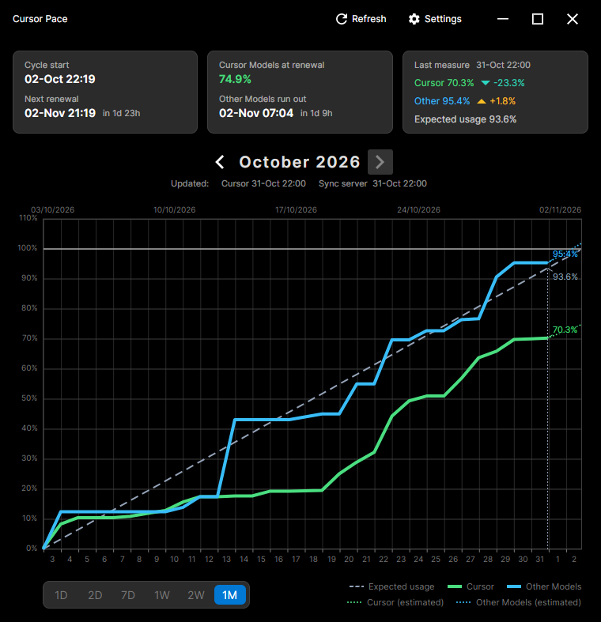

# CursorPace

**अन्य भाषाओं में पढ़ें:**

<small id="lang-list">[English](../README.md) · [Português (Brasil)](./README.pt-BR.md) · [Deutsch](./README.de.md) · [Español](./README.es.md) · [Français](./README.fr.md) · [हिन्दी](./README.hi.md) · [日本語](./README.ja.md) · [한국어](./README.ko.md) · [简体中文](./README.zh-Hans.md) · [繁體中文](./README.zh-Hant.md)</small>

<p align="center">
  
</p>

Windows, Linux, और macOS के लिए डेस्कटॉप ऐप जो एक बिलिंग चक्र में Cursor मॉडल कोटा को ट्रैक करता है। उपयोग को स्वचालित रूप से प्राप्त करने के लिए अपने Cursor खाते से साइन इन करें। चार्ट दो स्वतंत्र प्रतिशत दिखाता है: **Cursor मॉडल** और **अन्य मॉडल**।

डैश वाली **अपेक्षित उपयोग** रेखा चक्र प्रारंभ पर 0% से अगले नवीनीकरण पर 100% तक एक सीधी गति है। Cursor और अन्य मॉडल आपके नमूनों का पालन करते हैं। एक अलग अनुमान दैनिक खपत और समाप्त होने के समय का अनुमान लगाता है। [QUICKSTART.md](QUICKSTART.hi.md) में चार्ट, ट्रे और सेटिंग्स शामिल हैं।

साइन इन एक एम्बेडेड नेटिव WebView (Windows पर WebView2, macOS पर WKWebView, Linux पर WebKitGTK) और आपकी Cursor डैशबोर्ड सेशन का उपयोग करता है। कोई आधिकारिक पर्सनल-प्लान API नहीं है और कोई टीम API कुंजी नहीं है।

## आवश्यकताएँ

- Windows 10 या 11 x64, Linux x64 या ARM64, या macOS (Intel या Apple Silicon)
- Windows रिलीज़ इंस्टाल के लिए: ऐप पेलोड स्व-निहित है। **साइन इन करें** को [Microsoft Edge WebView2 Runtime](https://go.microsoft.com/fwlink/p/?LinkId=2124703) की भी आवश्यकता है (जो अधिकांश Windows 11 PC पर पहले से मौजूद है; यदि यह गायब है तो इंस्टालर डाउनलोड पेज प्रदान करता है)
- Linux: WebKitGTK 4.1 (`libwebkit2gtk-4.1-0`; WPE Avalonia WebView बिल्ड के आधार पर काम कर सकता है)। GNOME ट्रे आइकन को AppIndicator एक्सटेंशन की आवश्यकता हो सकती है। ऐप बंडल किए गए इंटर का उपयोग करता है और सिस्टम `.woff` फोंट को अनदेखा करता है ताकि एक WOFF डिफ़ॉल्ट फेस स्टार्टअप को हैंग या क्रैश न कर सके।
- macOS: WKWebView (बिल्ट इन)। रिलीज़ अहस्ताक्षरित हैं; Gatekeeper को **सिस्टम सेटिंग्स → गोपनीयता और सुरक्षा** में **फिर भी खोलें** की आवश्यकता हो सकती है।
- स्रोत से बनाने के लिए: [.NET 10 SDK](https://dotnet.microsoft.com/download)

## स्थापित करें

1. अपने प्लेटफ़ॉर्म के लिए बिल्ड इस रिपॉजिटरी के रिलीज़ पेज से डाउनलोड करें:
   - **Windows**: `CursorPace-*-win-x64-setup.exe`
   - **Linux**: `CursorPace-*-linux-x64.AppImage` या `*-linux-x64.deb` (x86_64), या संगत `linux-arm64` फ़ाइलें (ARM64)
   - **macOS**: `CursorPace-*-osx-arm64.dmg` (Apple सिलिकॉन) या `*-osx-x64.dmg` (Intel)
2. **Windows**: इंस्टॉलर चलाएँ। यदि SmartScreen चेतावनी देता है कि ऐप अहस्ताक्षरित है, तो **अधिक जानकारी** चुनें, फिर **फिर भी चलाएँ**। यदि WebView2 Runtime गुम है, तो इंस्टॉलर द्वारा दी गई डाउनलोड पेज खोलें।
3. **Linux**: AppImage को निष्पादन योग्य बनाएँ (`chmod +x`), फिर इसे चलाएँ। बंडल के एक्सट्रेक्ट होने के दौरान पहली बार लॉन्च होने में थोड़ा समय लग सकता है। Debian या Ubuntu पर, `sudo apt install ./CursorPace-*.deb` पैकेज को इंस्टॉल करता है और GTK/WebKit निर्भरताओं को खींचता है।
4. **macOS**: DMG खोलें, `CursorPace.app` को Applications में खींचें, फिर इसे खोलें। यदि Gatekeeper अहस्ताक्षरित ऐप को ब्लॉक करता है, तो एक बार **खोलें** पर राइट-क्लिक करें, फिर **सिस्टम सेटिंग्स → गोपनीयता और सुरक्षा** में **फिर भी खोलें** चुनें।
5. Cursor में साइन इन करें। यदि **सूचना ट्रे में शुरू करें** चालू है (डिफ़ॉल्ट रूप से), तो पहले ट्रे आइकन से विंडो खोलें, या `--show` के साथ लॉन्च करें।

पहली बार के सेटअप, Cursor खाता साइन-इन, उपयोग चार्ट, ट्रे व्यवहार और समस्या निवारण के लिए [QUICKSTART.md](QUICKSTART.hi.md) देखें।

## विशेषताएँ

- Cursor में साइन इन करें और मांग पर उपयोग को रीफ़्रेश करें, या स्वचालित रूप से हर 1, 2, 4, 6, या 12 घंटे में
- बिलिंग चक्र प्रारंभ और अगला नवीनीकरण Cursor से आते हैं। पिछला और अगला पहले से संग्रहीत चक्रों को खोलते हैं
- चक्र की तारीखों, प्रत्येक मॉडल के पूर्वानुमान, और अपेक्षित गति के मुकाबले नवीनतम रीडिंग के लिए सारांश कार्ड
- चार्ट रेंज **1D**, **2D**, **7D**, **1W**, **2W**, और **1M**, ड्रैग-टू-ज़ूम और एक पॉइंटर रीडआउट के साथ
- नोटिफिकेशन ट्रे में बंद हो जाता है। लॉगिन पर वैकल्पिक लॉन्च। दूसरा लॉन्च पहले से चल रही विंडो को खोलता है।
- लाइट, डार्क या सिस्टम थीम, और `locales/ui-languages.json` से ली गई भाषा का विकल्प। यदि वह फ़ाइल गुम है, तो एकमात्र विकल्प अंग्रेज़ी है। विंडो अपना आकार, स्थिति और अधिकतम की गई स्थिति याद रखती है।
- उपयोग को CSV के रूप में निर्यात करें, और सेटिंग्स और सैंपलों का बैकअप लें या पुनर्स्थापित करें।
- **वैकल्पिक।** [CursorPace सिंक सर्वर](https://github.com/wsj-br/CursorPace-SyncServer) स्थानीय नेटवर्क पर CursorPace इंस्टॉलेशन को सिंक्रनाइज़ रखता है। यह उपयोग के नमूने और बिलिंग-साइकिल की सीमाएँ साझा करता है, ताकि एक ही डेवलपमेंट एनवायरनमेंट में एक मैक, एक विंडोज पीसी और एक लिनक्स मशीन एक ही चार्ट दिखाए। उस रिपॉजिटरी से सर्वर को इंस्टॉल और चलाएँ।

## स्रोत से बनाएँ

Windows (PowerShell) या Linux/macOS (bash) पर:

```bash
dotnet restore
dotnet build
dotnet test ./Tests/CursorPace.Tests.csproj
dotnet run --project ./CursorPace.csproj
```

या मेंटेनर स्क्रिप्ट का उपयोग करें: `.\scripts\dev.ps1` / `./scripts/dev.sh`। ये स्क्रिप्ट डिफ़ॉल्ट रूप से विंडो दिखाते हैं; ऐप की सामान्य शुरुआत दृश्यता का उपयोग करने के लिए `.\scripts\dev.ps1 -NoShow` या `./scripts/dev.sh --no-show` का उपयोग करें।

स्व-निहित प्रकाशित करें (`PublishSingleFile=false` रखें):

```bash
dotnet publish -c Release -r linux-x64 --self-contained -p:PublishSingleFile=false
dotnet publish -c Release -r linux-arm64 --self-contained -p:PublishSingleFile=false
dotnet publish -c Release -r osx-arm64 --self-contained -p:PublishSingleFile=false
dotnet publish -c Release -r osx-x64 --self-contained -p:PublishSingleFile=false
dotnet publish -c Release -r win-x64 --self-contained -p:PublishSingleFile=false
```

Linux साइन-इन के लिए उस मशीन पर WebKitGTK 4.1 इंस्टॉल होना चाहिए जो प्रकाशित बाइनरी चलाती है।
Linux पर बैकग्राउंड उपयोग रीफ़्रेश 1x1 पारदर्शी WebView होस्ट का उपयोग करता है ताकि यह
साइन-इन विंडो को फ़्लैश न करे; macOS और Windows उस होस्ट को लॉगिन आकार में स्क्रीन से बाहर रखते हैं।

यह प्रोजेक्ट macOS `CGRect`/`CGSize` ABI की शुद्धता के लिए `vendor/` के तहत Avalonia.Controls.WebView 12.1.0 का एक छोटा संगतता बिल्ड रखता है। किसी अलग macOS WebView रनटाइम की आवश्यकता नहीं है।

रिलीज़ पैकेजिंग:

```powershell
.\scripts\build.ps1          # Windows: Inno Setup installer
```

```bash
./scripts/build.sh             # Linux: AppImage and .deb; macOS: DMG
```

केवल प्रकाशित करें (पैकेजिंग छोड़ें): `--skip-installer` / `-SkipInstaller` जोड़ें।

पूर्ण योगदानकर्ता वर्कफ़्लो [dev/DEVELOPMENT.md](../dev/DEVELOPMENT.md) में है।

## दस्तावेज़

| दस्तावेज़ | दर्शक |
| --- | --- |
| [QUICKSTART.md](QUICKSTART.hi.md) | इंस्टॉल करें, साइन-इन करें, दैनिक उपयोग, समस्या निवारण |
| [dev/DEVELOPMENT.md](../dev/DEVELOPMENT.md) | बिल्ड करें, परीक्षण करें, चलाएँ, पैकेज करें, योगदान दें |
| [dev/CHANGELOG.md](../dev/CHANGELOG.md) | उपयोगकर्ता-दृश्यमान परिवर्तन |

## अस्वीकरण

[Cursor](https://cursor.com/home) Anysphere, Inc. का एक उत्पाद है। CursorPace एक स्वतंत्र प्रोजेक्ट है और Cursor या Anysphere से संबद्ध या समर्थित नहीं है।

## लाइसेंस

कॉपीराइट 2026 Waldemar Scudeller Jr.

यह सॉफ़्टवेयर MIT लाइसेंस के तहत लाइसेंस प्राप्त है। विवरण के लिए [LICENSE](../LICENSE) फ़ाइल देखें।

इस पृष्ठ के अनुवाद स्वचालित रूप से तैयार किए जाते हैं। जब कोई अनुवाद ऐप से असहमत हो तो इस अंग्रेज़ी पृष्ठ को प्राथमिकता दें।
